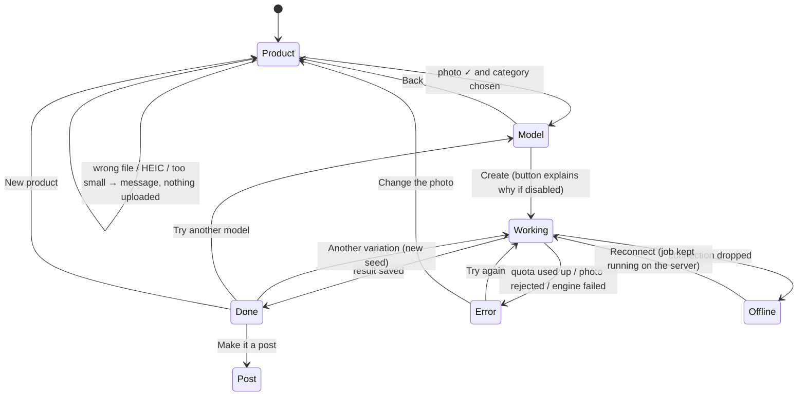
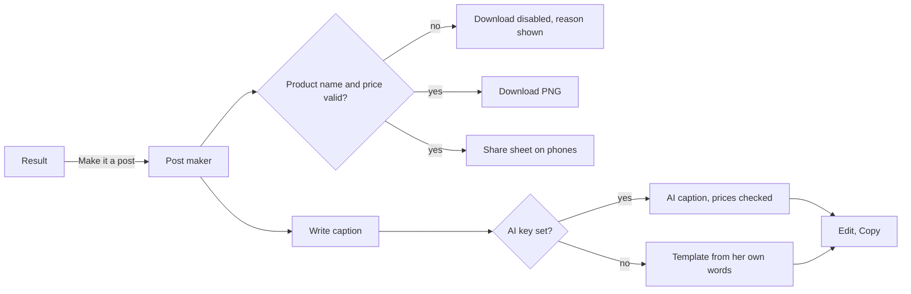
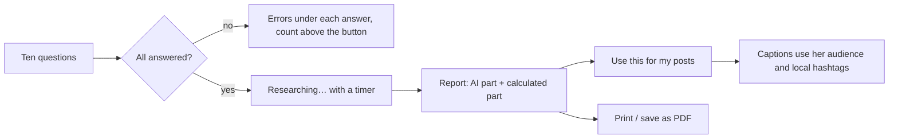

# 02 · Journeys and flows

## The whole journey — Priya's Monday

| Stage | What she does | What she feels | What the product does |
|---|---|---|---|
| **1. Find** | Opens the link a friend shared | Curious, a bit sceptical | The home page shows a real before/after she can drag — proof before any promise |
| **2. Photo** | Photographs a kurti on her bed, uploads it | Hopeful; worried it'll look fake | Accepts phone photos as they are; straightens and cleans them; asks only "what is it?" and "who wears it?" |
| **3. Wait** | Watches for ~20 seconds | Impatient | A live panel shows each real stage — queue position, then "dressing the model" — so the wait feels like work, not a freeze |
| **4. Check** | Drags the slider; zooms full-screen | Judging: *does it still look like my kurti?* | Before/after on the same model, full screen, product thumbnail beside it |
| **5. Post** | Adds name, ₹799, MRP ₹999, "Diwali sale" | Wants it to look professional | Live preview; the discount is calculated; three looks; text never covers the garment |
| **6. Caption** | Taps "Write caption", picks Hinglish | Relief | A caption in her buyers' language, using her exact price — editable |
| **7. Share** | Taps Share → Instagram | Done | The phone's share sheet; the caption is already on the clipboard |
| **8. Plan** *(once)* | Answers ten questions | Wants direction | A report: who buys, a 7-day plan, what she earns per piece, Diwali in 13 days |

**Moments that matter most:** stage 4 (trust — if the garment changed, she
won't post it) and stage 7 (if posting takes more than a tap or two, she'll go
back to her old way).

## Studio flow and its states

**Rules that shape the flow**

- **Steps unlock in order.** You can't reach Model without a photo and a category;
  the step tabs explain why if you try.
- **Nothing is lost by leaving.** The URL becomes `/studio?r=<id>` as soon as the
  server accepts the job; reload or come back later and it reconnects.
- **Steps lock while a photo is being made**, so a second click can't start a
  second job and spend more free GPU time.
- **Repeats are free.** The same garment, model and settings return the saved
  photo instantly, and the panel says "no GPU used".

## Post maker flow

Shop name, handle and how people order are **remembered** on her phone, so the
second post is three fields: product, price, MRP.

## Research flow

The report separates what the AI suggests (buyers, trends, pricing, plan) from
what is **calculated** and exact (profit per piece, margin, dates of selling days),
and labels both.
